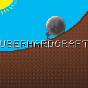

<div align="center">

[](https://github.com/Sawyer128/uberHardCraft)
# uberHardCraft
*Making Minecraft fun again, the hard way.*

[![Modrinth](https://img.shields.io/badge/dynamic/json?labelColor=black&color=grey&label=&suffix=%20downloads&query=downloads&url=https://api.modrinth.com/v2/project/3jwYFXVE&style=flat&logo=data:image/png;base64,iVBORw0KGgoAAAANSUhEUgAAACAAAAAgCAMAAABEpIrGAAAAIGNIUk0AAHomAACAhAAA+gAAAIDoAAB1MAAA6mAAADqYAAAXcJy6UTwAAAJPUExURQAAABvZahWnUha1WAYzGQlHIxvZahvZahvZahvZahvZahvZahvZahvZahvZahvZahvZahvZahvZahvZahvZahvZahvZahvZahvZahvZahvZahvZahvZahvZahvZahvZahvZahvZahvZahvZahvZahvZahvZahvZahvZahvZahvZahvZahvZahvZahvZahvZahvZahvZahvZahvZahvZahvZahvZahvZahvZahvZahvZahvZahvZahvZahvZahvZahvZahvZahvZahvZahvZahvZahvZahvZahvZahvZahvZahvZahvZahvZahvZahvZahvZahvZahvZahvZahvZahvZahvZahvZahvZahvZahvZahvZahvZahvZahvZahvZahvZahvZahvZahvZahvZahvZahvZahvZahvZahvZahvZahvZahvZahvZahvZahvZahvZahvZahvZahvZahvZahvZahvZahvZahvZahvZahvZahvZahvZahvZahvZahvZahvZahvZahvZahvZahvZahvZahvZahvZahvZahvZahvZahvZahvZahvZahvZahvZahvZahvZahvZahvZahvZahvZahvZahvZahvZahvZahvZahvZahvZahvZahvZahvZahvZahvZahvZahvZahvZahvZahvZahvZahvZahvZahvZahvZahvZahvZahvZahvZahvZahvZahvZahvZahvZahvZahvZahvZahvZahvZahvZahvZahvZahvZahvZahvZahvZahvZahvZahvZav///9ScwmYAAADDdFJOUwAAAAAAAA8zW3uOYwIBK3rB6Pn+ml18KiGL5HEDquOIH07R/UzKz2zu+uLHIibtafWkVCMNBRqg7/RQuT8EQbvT+5ETDBSU/NAgCSdZlcQKii7mtxJY5fF/7D1SRkB+EcWh4UilOOtPMdTCR1PqN969vmGDCw7G4DSSsAcGHrSPr3bds5CEwDKoXumcZdwcG4KmjayX32A79pjOqRjIFoXynVYVgPi6qxDnL78p2obVJFquNbGZCPdyvHPZ1yhuh8s+iRzcsrEAAAABYktHRMQUDBvhAAAAB3RJTUUH5wQXDwgZWDUtiQAAAqRJREFUOMttU/k7lFEU/k4L4hsxtNAnhRgiJZOiSfbI2oJpmRFCi2kV0aaNVLTIEpVISmnf97r/WO+534yZnqfzw73vOe+559xz7rmKIoVYvLx95vj6qUSqVBW3sGrwnxsQaAwSwcDz5i9g0wxPfmFIqJCyiEgLE4vDl7iD8PGlETotIqOQahlAdJTLA5sWY5JsbNzysHiihEBWViRqRDOlgyFmJVtMq5JWJ5vhvyZlLevrEmUILKl8PihtvYWcYt6QLmNwFjjEb4SSkZnlZLO5yJzcPBg35bODwZfPZxYwWbC5sKjYzwBUkssxSg1wKNsCtHUb89vTy3GwopBxDmcJ9YdDJYB1B9t2WmUtcbtkqt18Mxsp9irsezS2VEu+uka/mqUWSrFd2VsnhLEetoZ9TFv3HwCexdUdjBWi0aH4YTuEvtoPM3/EO1nnuTpEjD2qHIM54DhR0wmA5hZySzIntyknsbZyi8IB0tp07tRpBDKfgeWsdDjHDlFGRIjnl3O0t573gcMFUBeVS1gvlxB1dOZxv0pIu9IF01UDZRdjr1SuZQhxvbvnRrmsMePmrdsrGPRaKP8OLtmn9KM7A4N3xb8yNExUb5RlZt2btpZbXajzPoYkBaDKrtADp3HkYdloo56ndgx37UcHxSP0tIWBGH9cg1nx6TJFTNhS7eCfcA1PJ+GgDbLDs2GuX3V05Ohj0xYSBGumyq/yfApw4EWTRxPJqxQvIF6+ks9Gr0d4nN+8Nbhoi+NdJEwVSc6hVNvHOUvg+5qeDxoP3GQz6x8/qXLuZ6Op7SPy+gNTnydSELabk1Z8Mbs/hlr4dbobfUgxJMS3UdXza9H33jqnA3/OH41FCZ7/l7HW8vOXiWc9GvPf06D953/T2O/EP8HBNtcH0Zm/lqFNUgTAex4AAAAldEVYdGRhdGU6Y3JlYXRlADIwMjMtMDQtMjNUMTU6MDg6MjQrMDA6MDAE5dOaAAAAJXRFWHRkYXRlOm1vZGlmeQAyMDIzLTA0LTIzVDE1OjA4OjI0KzAwOjAwdbhrJgAAACh0RVh0ZGF0ZTp0aW1lc3RhbXAAMjAyMy0wNC0yM1QxNTowODoyNSswMDowMITaQU0AAAAASUVORK5CYII=)](https://modrinth.com/mod/uberhardcraft)
[](https://modrinth.com/mod/uberhardcraft)\
[](https://discord.gg/8Smu5AJbvu)

</div>

## Install

The best way to install with the mod is through [Modrinth](https://modrinth.com/mod/uberhardcraft).

[FabricAPI](https://modrinth.com/mod/fabric-api) is required!

## Purpose & About

This fabric mod aims to upgrade the progression of Minecraft by improving all the subsystems. For example, farming has been in the game for years and yet is still almost exactly the same as when originally implemented. With this mod, systems like farming will receive a rework that requires much more time and effort from the player.

## Roadmap
<details>
    <summary> List of Features </summary>

    Flint Expansion:
    - Flint Plates
        - Flint Pickaxe Head
        - Flint Shovel Head
        - Flint Axe Head
    - Flint Pickaxe
    - Flint Shovel
    - Flint Axe

    Metallurgy
    - Blank Mold
        - Pickaxe Head Mold
        - Axe Head Mold
        - Shovel Head Mold

    Misc
    - Wooden Sift
    - Bark Fiber
   
    Planned Features
    - Add the kiln
        - Kiln Rack
        - Kiln Block
            - Logic so that the kiln (rack, fire, and fuel) need to be completely covered by either clay, kiln blocks, dirt, or other insulating blocks.
        - Kiln Fire
            - Logic so the kiln fire need to be refueled in order to keep burning
        - Kiln Vent
            - Logic so the kiln fire will only work when supplied with airflow
        - Kiln Hatch
    - Crucible 
    - Fix some stupid item/block identifiers like blank_mold instead of mold_blank and new_flint to flint_plate
</details>

## Building

For Arch, the `jdk-openjdk` and `gradle` packages are required.

Clone the repository with `git clone https://github.com/Sawyer128/uberHardCraft`

Enter the directory and build with `./gradlew build` *(you may have to run with sudo: `sudo sh gradlew build`)*

```
sudo pacman -S git jdp-openjdk gradle
git clone https://github.com/Sawyer128/uberHardCraft
cd uberHardCraft
./gradlew build
```

The jar lands in `build/libs/`

## License

This mod is available under the CC0 license. Feel free to learn from it and incorporate it in your own projects.

## Star History

[](https://github.com/Sawyer128/uberHardCraft)